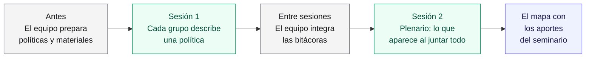
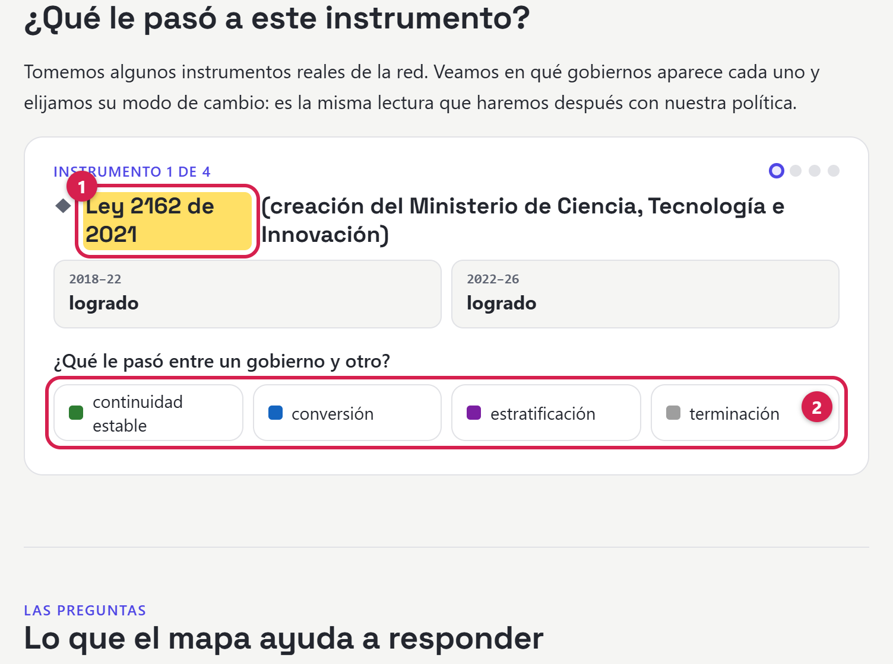
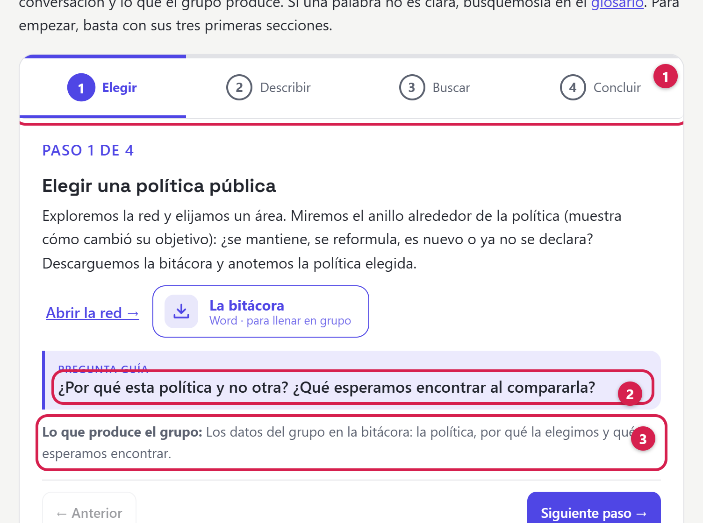

## Resumen

Cuando cambia el gobierno, cada entidad deja un informe de empalme al siguiente. El mapa reúne los
de Ciencia, Tecnología e Innovación de los gobiernos de Duque (2018–2022) y Petro (2022–2026). Es un
borrador que generó un modelo de lenguaje. En dos sesiones, el seminario TRAMA lo revisa por grupos: cada grupo
describe una política y deja una bitácora. En la sesión 2 aparecen los patrones que ningún grupo ve
solo, y lo que corrigen los grupos vuelve al mapa.

> **Verifíquelo en el mapa.** El mapa está publicado en
> [https://complexluise.github.io/laboratorio-cocreacion-empalme-colombia/#/red](https://complexluise.github.io/laboratorio-cocreacion-empalme-colombia/#/red).
> Los materiales del taller se descargan del mismo sitio:
>
> - la bitácora en blanco: [bitacora-laboratorio.docx](https://complexluise.github.io/laboratorio-cocreacion-empalme-colombia/bitacora-laboratorio.docx);
> - un ejemplo lleno: [bitacora-ejemplo-ctei.docx](https://complexluise.github.io/laboratorio-cocreacion-empalme-colombia/bitacora-ejemplo-ctei.docx);
> - la red en Excel: [red-ciencia-tecnologia.xlsx](https://complexluise.github.io/laboratorio-cocreacion-empalme-colombia/red-ciencia-tecnologia.xlsx).

## La serie

Cuatro documentos explican el laboratorio:

1. **Marco teórico**: de dónde salen las categorías del mapa.
2. **Ontología del mapa**: qué contiene el mapa y cómo se relacionan sus piezas.
3. **Cómo lo hicimos**: el método, qué hizo un modelo de lenguaje y qué revisaron personas.
4. **Encuadre de la actividad** (este documento): cómo se usa el mapa en el seminario.

## Mapa de lectura

| Sección | Pregunta que responde |
|---|---|
| 1. Por qué en grupos | ¿Qué se gana con trabajar por partes? |
| 2. Qué hace cada grupo | ¿Por qué una política y no un sector? |
| 3. Cómo se eligen las políticas | ¿Qué prepara el equipo antes de la sesión? |
| 4. La práctica previa | ¿Cómo se ensaya la lectura? |
| 5. El recorrido de cuatro pasos | ¿Qué hace el grupo en la sesión 1? |
| 6. La bitácora | ¿Qué deja escrito cada grupo y qué pasa entre sesiones? |
| 7. La sesión 2 | ¿Qué aparece al juntar todo? |
| 8. Lo que falta decidir | ¿Qué está abierto? |

## 1. Por qué en grupos

**Cada grupo trabaja una sola política; ninguno ve el conjunto.** Lo que buscamos
aparece al juntar el trabajo de todos: instrumentos que comparten varias políticas, modos de cambio
que se repiten. A eso se le llama **emergencia**: un patrón que surge de la interacción de las partes
y que ninguna muestra sola.

La actividad tiene cuatro momentos (Figura 1), y este documento sigue su orden.

*Figura 1. Los cuatro momentos de la actividad. Gris: trabajo del equipo organizador. Verde:
trabajo de los grupos. Azul: el resultado, el primer acto de cocreación del laboratorio.*

## 2. Qué hace cada grupo

**El sector no es la unidad de trabajo: lo es la política.** Un sector como Ciencia, Tecnología e
Innovación tiene 14 políticas y 93 instrumentos; es demasiado para una sesión. Una política tiene
entre 5 y 27 instrumentos, una escala que un grupo puede recorrer.

La actividad trabaja con tres niveles y dos categorías de cambio:

| Término | Qué es | Papel en la actividad |
|---|---|---|
| Sector | La agrupación bajo la que se publican los informes de empalme | Fuente de las políticas y escala de comparación en el plenario. Hoy solo está publicado Ciencia, Tecnología e Innovación |
| Política pública | Un área que atraviesa gobiernos, con el objetivo que declara cada uno | **La unidad que elige cada grupo** |
| Instrumento | El medio concreto con que el Estado actúa | Lo que el grupo compara dentro de su política |
| Modo de cambio | Qué le pasó a un instrumento entre los dos gobiernos | El mapa usa seis; la práctica (sección 4) ensaya los cuatro más frecuentes: continuidad estable (sigue igual), conversión (cambia de uso), estratificación (se suma) y terminación (se deja) |
| Cambio del objetivo | Qué pasó con el objetivo de la política | Se mantiene, se reformula, nuevo o no declarado |

Cada grupo elige una política y la describe entre los dos gobiernos: el de Iván Duque (2018–2022) y
el de Gustavo Petro (2022–2026). No se queda en el informe de empalme: busca **información
complementaria** (sección 5, paso 3).

**La red es un borrador, no una fuente.** Un modelo de lenguaje, Claude Sonnet de Anthropic
([versión por confirmar]), la generó, y nadie la ha revisado completa (ver **Cómo lo hicimos**,
sección 4). El grupo la usa para ubicarse, y construye su bitácora con los informes y las otras
fuentes. Si encuentra un error en la red, lo anota: es parte del trabajo.

## 3. Antes: cómo se eligen las políticas

**Las políticas no vienen dadas.** Las 14 áreas son una propuesta de un modelo de lenguaje (Claude
Opus 4.8, de Anthropic); el equipo aprobó cómo se dividieron (ver **Cómo lo hicimos**, paso 6).
Antes de la sesión, el equipo decide cuáles ofrece a los grupos.

**Condiciones para ser ofrecida.** Cada área debe cumplir las cuatro:

- tiene un **objetivo o problema público** identificable;
- se persigue con **más de un instrumento**;
- tiene un **ancla institucional**: una entidad responsable o un documento que la formaliza;
- tiene **evidencia suficiente** en el informe: páginas y cifras.

**Criterios para elegir entre las que las cumplen:**

- **Prioridad a las que tienen evidencia en los dos gobiernos**, porque ahí se ve el cambio. Puede
  sumarse una que esté en un solo gobierno, como caso de área nueva o de objetivo no declarado.
- **Carga comparable** entre grupos: un número de instrumentos que se pueda trabajar en una sesión.
- **Diversidad:** varias políticas del sector.

Un buen candidato es un **área huérfana**: sin objetivo declarado por el gobierno posterior, pero
con instrumentos activos. En el sector hay una, la innovación empresarial: 4 de sus 8 instrumentos
siguen activos (ver **Marco teórico**, Figura 6).

## 4. La práctica previa

**Antes de empezar, el grupo clasifica instrumentos reales.** La práctica «¿Qué le pasó a este
instrumento?» muestra cuatro instrumentos de la red, con su presencia en cada informe, y pide elegir
su modo de cambio (Figura 2). Es la misma lectura que el grupo hará después con su política.

{width=70%}

*Figura 2. La práctica. (1) Un instrumento real: la Ley 2162 de 2021, presente en los dos informes.
(2) Los modos de cambio para elegir. Si la respuesta no coincide con la del mapa, el sitio da una
pista. La respuesta de referencia es salida del modelo, sin verificar: si el grupo discrepa, lo
anota en la bitácora, sección 3.*

El equipo eligió un ejemplo por modo y dejó fuera los instrumentos con inconsistencias conocidas.

## 5. El recorrido de cuatro pasos

**La sesión 1 cabe en cuatro pasos.** El sitio muestra los cuatro pasos uno a uno (Figura 3).

{width=70%}

*Figura 3. El recorrido en la portada del sitio. (1) Las pestañas de los cuatro pasos. (2) La
pregunta que guía la conversación en el paso 1. (3) Lo que el grupo produce en ese paso.*

El recorrido está en la portada del sitio: [https://complexluise.github.io/laboratorio-cocreacion-empalme-colombia/](https://complexluise.github.io/laboratorio-cocreacion-empalme-colombia/).

| Paso | Qué hace el grupo | Material | Pregunta guía | Lo que produce |
|---|---|---|---|---|
| 1. Elegir | El grupo explora la red y elige un área; mira el anillo alrededor de la política, que indica cómo cambió su objetivo | La red y la bitácora | ¿Por qué esta política y no otra? ¿Qué esperamos encontrar al compararla? | Los datos del grupo en la bitácora |
| 2. Describir | El grupo ubica la política en el informe de cada gobierno y compara sus instrumentos | La red en Excel; la tabla puente (sección 6) | ¿Qué instrumentos siguen, cuáles cambian de uso, cuáles se suman y cuáles se dejan? | Las secciones 1 a 3 de la bitácora |
| 3. Buscar | El grupo busca información complementaria | El glosario; fuentes complementarias | ¿Estas cifras miden lo mismo en los dos gobiernos? ¿Contra qué meta se comparan? | Las secciones 4 y 5 |
| 4. Concluir | El grupo cierra con lo aprendido y una hipótesis para el plenario | El ejemplo lleno | ¿Qué le falta al mapa? | Las secciones 6 y 7, y la bitácora entregada |

En el paso 3, la información complementaria sale de varias fuentes:

- **Sinergia**, el Sistema Nacional de Evaluación de Gestión y Resultados, donde el Departamento
  Nacional de Planeación sigue las metas del Gobierno.
- **El Plan Nacional de Desarrollo** de cada gobierno.
- **Las leyes y los documentos CONPES**: las políticas que aprueba el Consejo Nacional de Política
  Económica y Social.

## 6. La bitácora

**Cada grupo deja su trabajo en un archivo de Word en blanco.** Se llena en Word o en Google Docs.
Para que un programa pueda leerla después, hay dos reglas:

- **No cambiar los títulos de las tablas ni de las filas.**
- **Escribir «Sin dato» cuando la fuente no dice algo.** Es un hueco declarado, un hallazgo, y se
  puede aclarar: «Sin dato: el balance no lo desagrega». Una celda vacía, en cambio, significa que
  el grupo no la llenó.

La bitácora tiene siete secciones:

| Sección | Qué deja el grupo |
|---|---|
| 1. Ubicar la política | Dónde está la política en el informe de cada gobierno, cómo reporta su avance y la tabla puente |
| 2. Los instrumentos | Hasta tres instrumentos: qué pasó con cada uno y por qué importa |
| 3. Co-construyamos la red | Lo que el grupo corrige, añade, conecta o reclasifica en la red, con su evidencia |
| 4. Las siete subcategorías, lado a lado | Objetivo, instituciones, población, normativa, recursos, metas e impacto, en cada gobierno |
| 5. Fuentes complementarias | Las fuentes externas que usó el grupo |
| 6. En términos de complejidad | Qué patrones cree el grupo que aparecerán al juntar las políticas |
| 7. Conclusiones | El hallazgo principal y la hipótesis para la sesión 2 |

**La tabla puente evita comparar manzanas con peras.** Antes de comparar cifras, el grupo deja
escrito si los dos gobiernos miden lo mismo. En el ejemplo del sector, el informe de 2018–2022
reporta la política con un 94,41 % de cumplimiento de la meta del cuatrienio, la que fija cada
gobierno para sus cuatro años. El de 2022–2026 la reparte en dos líneas, sin un porcentaje único.
Sin la tabla puente, comparar esas cifras engaña.

El ejemplo lleno lo escribió el equipo; lo que un modelo de lenguaje (Claude, de Anthropic;
[versión por confirmar]) agregó en la última revisión del formato está sin revisar. De ese ejemplo
salen dos lecciones más:

- **El cambio de enfoque del objetivo** es lo primero que se ve. En el ejemplo, que toma el sector
  completo, el objetivo pasa de movilizar talento e impulsar empresas de base tecnológica a
  consolidar capacidades con enfoque territorial y de cierre de brechas. Ese cambio ordena la
  lectura de los instrumentos.
- **El impacto está vacío en los dos informes**: solo hay cifras de gestión (lo que hizo la
  entidad) o de producto (lo que entregó), no de impacto (lo que cambió para la gente). Es un
  hallazgo, no una falla del grupo.

**Entre sesiones, el equipo integra las bitácoras.** Un programa convierte cada una en datos, y el
equipo los suma al mapa como una capa aparte: los aportes del seminario no borran lo que generó el
modelo.

## 7. La sesión 2: lo que aparece al juntar todo

**Una hipótesis del equipo: los instrumentos de dinero y de organización persisten más que los
objetivos de política.** «Persistir» puede ser seguir apareciendo o seguir con el mismo uso. Con
ninguna de las dos lecturas el mapa apoya la hipótesis. Siguen con el mismo uso 3 de 12
instrumentos de tesoro y 3 de 9 de organización, frente a 4 de 8 objetivos. Siguen apareciendo 9
de 12 y 3 de 9, frente a 7 de 8. El dinero reaparece más que la organización, pero menos que los
objetivos.

La tabla agrupa los instrumentos por el recurso del Estado que usan, según Christopher Hood (ver
**Marco teórico**, sección 3.2): nodalidad, autoridad, tesoro y organización (NATO, por sus
iniciales en inglés).

| De lo que había en 2018–2022 | Sigue en 2022–2026 | Sigue con el mismo uso |
|---|---|---|
| Instrumentos de tesoro (el dinero) | 9 de 12 | 3 de 12 |
| Instrumentos de autoridad (la norma) | 3 de 4 | 2 de 4 |
| Instrumentos de nodalidad (la información) | 6 de 10 | 4 de 10 |
| Instrumentos de organización (personal y medios propios) | 3 de 9 | 3 de 9 |
| Objetivos de política (áreas con objetivo declarado) | 7 de 8 | 4 de 8 |

Hay dos cautelas propias de este cálculo. Puede haber dos fichas para un mismo instrumento (ver
**Ontología del mapa**, sección 5). Y con grupos tan pequeños, una ficha mal clasificada cambia el
resultado. Por eso es una pregunta para el plenario, no una conclusión: el tipo de patrón que solo
se ve al juntar políticas.

La sesión 2 tiene tres momentos:

1. **El equipo muestra el mapa integrado**, con los aportes de todas las bitácoras.
2. **Se contrastan las hipótesis** que cada grupo dejó en la sesión 1 con lo que muestra el mapa.
3. **Plenario.** Se discute en dos escalas:
   - **Dentro de un sector:** instrumentos que comparten varias políticas, como un fondo o un
     sistema. Si dos grupos describen distinto el mismo instrumento, aparece una tensión que solo se
     ve al juntar.
   - **Entre sectores** (si hay más de uno): ¿predomina la estratificación? ¿Qué tipo de
     instrumento persiste más? ¿Un mismo gobierno suma en una política y deja instrumentos en otra?

## 8. Lo que falta decidir

- **Cuántas políticas se ofrecen** y cuáles, con los criterios de la sección 3.
- **El número de participantes y la duración** de cada sesión, que definen cuántos grupos hay.
- **Qué ve cada grupo en la sesión 1.** Lo recomendado es que cada grupo vea solo su política, para
  que la integración sea reveladora. El sitio publica la red completa, y el paso 1 pide explorarla.
  El sitio ya permite aislar una política: al seleccionarla, la red muestra solo sus instrumentos.
  Falta que el equipo decida si el paso 1 empieza así.
- **Otros sectores.** Si no están listos para el seminario, las políticas salen solo de Ciencia,
  Tecnología e Innovación.

## Autoría y uso de inteligencia artificial

**Autoría:** Mercy Garcia, Elizabeth Mesa y Luis Higuera, Laboratorio de cocreación TRAMA.

**Contribuciones:**

- **Conceptualización:** Mercy Garcia y Elizabeth Mesa, en reuniones de trabajo del equipo.
- **Metodología y curaduría de datos:** Luis Higuera.
- **Revisión:** pendiente.

**Uso de inteligencia artificial:** Luis Higuera trabajó con Claude Code (Claude Opus 4.8 y Claude
Opus 5.5, de Anthropic) para convertir las decisiones del equipo en el mapa, el sitio y este
documento. El modelo generó los borradores, el código y la red; el equipo decidió. Un programa calculó las cifras sobre los datos del mapa, y otro tomó las capturas del sitio, las marcó y las recortó. Ninguna persona ha revisado todavía el documento completo.
