## Resumen

El mapa se hizo en nueve pasos. Cada paso lo hacen personas, un modelo de lenguaje o un programa
de reglas fijas, a veces dos de ellos juntos. El modelo generó casi todo el mapa; nadie lo ha
verificado completo. La receta se puede repetir con los informes de otros sectores.

> **Verifíquelo en el mapa.** El mapa está publicado en
> [https://complexluise.github.io/laboratorio-cocreacion-empalme-colombia/#/red](https://complexluise.github.io/laboratorio-cocreacion-empalme-colombia/#/red).
> Todas las páginas del sitio advierten que un modelo de lenguaje generó el contenido y que nadie lo
> ha revisado completo.

## La serie

Cuatro documentos explican el laboratorio:

1. **Marco teórico**: de dónde salen las categorías del mapa.
2. **Ontología del mapa**: qué contiene el mapa y cómo se relacionan sus piezas.
3. **Cómo lo hicimos** (este documento): el método, qué hizo un modelo de lenguaje y qué revisaron
   personas.
4. **Encuadre de la actividad**: cómo se usa el mapa en el seminario.

## Mapa de lectura

| Sección | Pregunta que responde |
|---|---|
| 1. Un primer borrador | ¿De dónde sale el mapa y qué tan confiable es? |
| 2. Tres clases de actores | ¿Quién hace cada cosa? |
| 3. La receta, paso a paso | ¿Cómo se hizo, y cómo repetirlo? |
| 4. Qué está revisado y qué falta | ¿Qué partes verificó una persona, y qué sigue pendiente? |
| Anexo. El registro | ¿Qué le pidió el equipo al modelo, con sus palabras? |

## 1. Un primer borrador

**El mapa sale de dos informes de empalme del sector de Ciencia, Tecnología e Innovación.** Un
informe de empalme es el que cada entidad deja al gobierno siguiente; aquí, los de Duque, 2018–2022,
y Petro, 2022–2026. Los publica el Departamento Nacional de Planeación (DNP), con sus anexos. Un modelo de lenguaje
procesó su texto y generó la red que publica el sitio. Ninguna persona la ha revisado completa:
puede tener errores de clasificación, de cifras o de citas.

Eso es parte del ejercicio, no un descuido. El modelo entrega un primer borrador, un insumo en
bruto. Ver otros patrones, notar lo sutil, discutir el método y marcar qué falta es trabajo de las
personas. El modelo amplía el alcance del equipo, pero no decide por él. Cada error que encuentre el
seminario mejora el mapa.

## 2. Tres clases de actores

**En la receta trabajan tres clases de actores, y no se pueden confundir.** Un **modelo de
lenguaje** no lee ni entiende: procesa texto y genera texto. Con el mismo encargo puede dar una
respuesta distinta cada vez. Un **programa** sigue reglas fijas: con los mismos datos, siempre da el
mismo resultado. Las **personas** deciden, aprueban y revisan.

Las ideas son del equipo. Mercy Garcia y Elizabeth Mesa conceptualizaron el laboratorio en
reuniones de trabajo: las categorías, el encuadre teórico y la actividad. Luis Higuera llevó esas
decisiones al mapa y al sitio trabajando con el modelo.

| Actor | Ejemplo en este mapa |
|---|---|
| Personas (el equipo y los grupos del seminario) | El equipo aprobó la división en 14 áreas |
| Modelo de lenguaje | Un modelo generó la lista de instrumentos de cada política |
| Programa | Un programa marcó «conversión» por defecto cuando ninguna consulta asignó un modo de cambio |

El equipo trabajó con dos familias de modelos: Gemini, de Google, y Claude, de Anthropic.

| Modelo y versión | Qué generó | Dónde se cuenta |
|---|---|---|
| Claude Opus 4.8, de Anthropic, y Gemini, de Google | La primera versión, con ideas sueltas, descartada | Anexo, «Generar la red» |
| Gemini Flash-Lite, de Google (versión vigente al procesar) | La transcripción de los documentos escaneados | 2 |
| Gemini Flash, de Google (versión vigente al procesar) | Una primera red de instrumentos, descartada | 4 |
| Claude Sonnet, de Anthropic ([versión por confirmar]) | La red publicada: políticas, instrumentos, modos de cambio y relaciones | 4 |
| Claude Opus 4.8, de Anthropic | La propuesta de áreas de política | 6 |
| Claude Opus 4.8 y Claude Opus 5.5, de Anthropic | El código del sitio y de los programas, y el borrador de estos documentos | Anexo |

Los dos modelos Opus se usaron desde Claude Code: un programa que le hace consultas seguidas a
Claude.

## 3. La receta, paso a paso

**Una segunda corrida con el mismo encargo puede dar otra red.** Por eso la receta fija lo que no
cambia: los pasos, las categorías y quién da cada uno. Son nueve pasos, agrupados en tres fases
(Figura 1).

```mermaid
flowchart LR
    subgraph A["Preparar"]
        direction TB
        P1["1 · Reunir los documentos"]:::prog
        P2["2 · Pasarlos a texto"]:::mod
        P3["3 · Fijar las categorías"]:::pers
    end
    subgraph B["Generar"]
        direction TB
        P4["4 · Extraer, una política a la vez"]:::mod
        P5["5 · Unir los repetidos"]:::mod
        P6["6 · Agrupar en áreas"]:::mod
    end
    subgraph C["Revisar y publicar"]
        direction TB
        P7["7 · Verificar contra la fuente"]:::pend
        P8["8 · Comprobar y publicar"]:::prog
        P9["9 · Revisar en el seminario"]:::pers
    end
    A --> B --> C
    classDef pers fill:#ecfdf5,stroke:#059669,color:#064e3b;
    classDef mod fill:#fff7e6,stroke:#d97706,color:#431407;
    classDef prog fill:#f4f4f5,stroke:#71717a,color:#18181b;
    classDef pend fill:#fef2f2,stroke:#dc2626,color:#7f1d1d,stroke-dasharray: 5 3;
```

*Figura 1. La receta en tres fases. Verde: personas. Naranja: un modelo de lenguaje, con
participación de personas o de un programa en algunos pasos. Gris: un programa. Rojo punteado: el
paso de verificación, que está pendiente.*

### Preparar

**1 · Reunir los documentos (programa).** Un programa descargó los informes de empalme que publica
el DNP. Para el sector de Ciencia, Tecnología e Innovación se usaron los dos informes del Ministerio
de Ciencia, uno por gobierno, con sus anexos (actas y resoluciones). Los anexos sirvieron para
buscar cifras.

**2 · Pasarlos a texto (programa y modelo).** Un programa convirtió cada documento a texto, página
por página, para que cada dato pueda citar su página. Los documentos escaneados no tienen texto:
Gemini Flash-Lite generó la transcripción a partir de la imagen. Nadie revisó esas transcripciones
línea a línea. La instrucción que recibió el modelo fue:

> «Transcribe COMPLETAMENTE el texto de este documento escaneado en español. Es un acta o resolución
> oficial del Ministerio de Ciencia de Colombia. Devuelve solo el texto transcrito en markdown
> limpio, respetando encabezados, listas, tablas y firmas. No agregues comentarios ni resúmenes. Si
> una página está en blanco o ilegible, indícalo con [página ilegible].»

**3 · Fijar las categorías antes de procesar (personas).** El equipo fijó siete categorías antes de
procesar los informes. Son estas: política pública, instrumento, tipo de instrumento, presencia
en cada informe, modo de cambio, cambio del objetivo y relación entre instrumentos. El tipo sigue el
esquema NATO: nodalidad, autoridad, tesoro u organización, según el recurso del Estado que usa. Una
política pública es aquí un área que atraviesa gobiernos, con el objetivo que declara cada uno. El
modo de cambio dice cómo cambió un instrumento de un gobierno al otro. Sin categorías fijas, cada
consulta al modelo clasifica distinto y los dos gobiernos no se pueden comparar. De dónde salen esas
categorías está en el **Marco teórico**; cómo se guardan en el mapa, en la **Ontología del mapa**.

### Generar

**4 · Extraer, una política a la vez (modelo).** **La primera red de instrumentos se partió en
islas.** El equipo le encargó primero a Gemini Flash una red por gobierno. Los fondos que sirven a
muchas políticas quedaron asignados a una sola, y la red quedó casi desconectada. Después le encargó
a Claude Sonnet una red nueva, con una consulta por cada una de las 19 políticas que nombran los dos
informes. Cada consulta recibió el texto de los
informes, las categorías y este encargo (extracto):

> «Extrae los INSTRUMENTOS de la politica […] a lo largo de DOS gobiernos, leyendo los informes.
> […] Un INSTRUMENTO es el medio concreto con que el Estado actua: programa, norma, fondo/fuente de
> financiacion, convocatoria, sistema. […] modo_cambio GUIADO POR EVIDENCIA (compara nombres,
> logica y CIFRAS entre gobiernos; no por defecto) […] evidencia: por vigencia, paginas y cifras
> (texto tal cual). No inventes.»

**5 · Unir los repetidos (modelo y programa).** Un mismo instrumento aparece en varias políticas, o
con otro nombre en el otro gobierno. Una consulta al modelo generó una lista de nombres que podrían
ser el mismo instrumento, con el encargo de no unir los que solo comparten tema. Nadie revisó esa
lista. Después, un programa armó con reglas fijas una ficha por instrumento: su registro en el mapa,
con nombre, tipo, presencia y modo de cambio. La unión no es completa: quedan fichas duplicadas (ver
**Ontología del mapa**, sección 5).

**Una de esas reglas importa:** si un instrumento está en los dos informes y ninguna consulta le
asignó un modo de cambio, el programa le pone «conversión» (el mismo instrumento usado para otro
fin) por defecto. Los datos publicados no
dicen cuáles de las 8 conversiones salieron así: hay que revisarlas una por una.

**6 · Agrupar en áreas (modelo y personas).** Cada gobierno nombra sus políticas a su manera. El
modelo (Claude Opus 4.8) propuso juntar las 19 políticas que nombran los dos informes en 14 áreas
que atraviesan los dos gobiernos, con el objetivo que declara cada uno. El equipo fijó dos criterios
(cada misión es un área; apropiación social y ciencia abierta van por separado) y aprobó cómo se
dividieron las áreas. No revisó el contenido de cada una.

### Revisar y publicar

**7 · Verificar contra la fuente (pendiente).** Este paso compara cada instrumento con la página que
cita: primero con otra consulta al modelo, encargada de señalar errores, y después con personas.
**La red publicada no pasó por él:** ni con el modelo ni, dato por dato, con personas.

**8 · Comprobar y publicar (programa).** Un programa comprueba que los datos usen solo las
categorías fijadas y arma la red del sitio y la versión en Excel para el taller.

**9 · Revisar en el seminario (personas).** Cada grupo toma una política y la contrasta con los
informes y con otras fuentes. El equipo lleva al mapa lo que encuentren. Es la vía prevista para la
revisión humana que le falta a la red (ver **Encuadre de la actividad**, secciones 5 y 6).

## 4. Qué está revisado y qué falta

**Fuera de los informes, ninguna parte publicada está libre del modelo.** Las bitácoras de los
grupos serán la primera escrita solo por personas.

| Parte | Quién la hizo | Revisión humana | Qué falta |
|---|---|---|---|
| Informes de empalme | Las entidades de cada gobierno; los publica el DNP | Es la fuente: se usa tal cual | — |
| Texto de los informes escaneados | Gemini Flash-Lite, de Google | Ninguna | Cotejarlo con los documentos escaneados |
| La red (políticas, instrumentos, modos, relaciones) | Claude Sonnet y un programa que armó las fichas | Ninguna completa. 91 de los 93 instrumentos citan su página | Verificar contra la fuente (paso 7) · Separar las conversiones por defecto (paso 5) · Llenar el nivel de confianza (alto, medio o bajo), vacío en los 93 |
| Áreas de política | Claude Opus 4.8 las propuso; el equipo fijó criterios | Parcial: el equipo aprobó la división, no el contenido | Revisar el contenido de cada área |
| Textos del sitio, glosario y estos documentos | Claude Opus 4.8 y Claude Opus 5.5, a partir de las decisiones del equipo | Parcial: Luis Higuera leyó y corrigió el Marco teórico. Las definiciones teóricas están contrastadas solo en parte con los originales (ver **Marco teórico**, «Qué está cotejado con las fuentes») | Revisar los demás textos |
| Ejemplo de bitácora del sector | El equipo; el modelo lo pasó a la versión 4 | Parcial | Revisar lo que agregó el modelo en la versión 4 |
| Bitácoras de los grupos | Las escribirán los grupos del seminario | — | Todavía no existen |

Una parte cambia de estado en esta tabla solo cuando una persona la revisa.

**Un caso muestra por qué el paso 7 es el pendiente principal.** A la estrategia «Todo es Ciencia»
el modelo le asignó el modo deriva: el instrumento sigue vigente e igual, pero su entorno cambió. La descripción que
generó el mismo modelo habla, en cambio, de una «terminación funcional». Las dos salidas no pueden
valer a la vez, y solo una persona que vuelva al informe puede decidir cuál corregir (ver **Marco
teórico**, sección 3.3, Figura 5).

Para otro sector hay que repetir los pasos 1 a 9, incluida la revisión de sus áreas por el equipo.

## Anexo. El registro: lo que el equipo le pidió al modelo

Los mensajes se copian tal cual, con sus errores de tipeo. Después de cada uno va qué decidió el
equipo, qué generó el modelo y qué resultó.

Los mensajes usan términos de programación (commit, PR, issue, branch: formas de registrar y revisar
cambios en el código; v0.1, v0.2: números de versión del sitio). No hace falta entenderlos para
seguir el registro.

### Generar la red

Sin mensaje registrado. Un modelo de lenguaje (Claude Opus 4.8, de Anthropic) extrajo ideas sueltas
en lugar de instrumentos. El equipo descartó esa versión (ver **Marco teórico**, secciones 1 y 2). Los encargos de la red publicada están en los
pasos 2 y 4.

*Resultado:* la red de Ciencia, Tecnología e Innovación.

### Ordenar la forma de trabajar

> «Quiero que hagamos la epica #6. Antes de eso queremos implementar la disciplina kybernetes del
> repo de sostaina porque ese nos ayuda a interaciuar con Claude.»
>
> «Ya hice el commit del ci, confirmo el gitflow. ahora ten en cuenta que la epic conssite en
> pasarnos a svelte por lo tanto es necesario adoptar la demás parte de la disciplina espcial el uso
> de pnpm y etc. Lets work.»
>
> «ahora que veo es que a la red hace falta aplicar un algoritmo de node overlapping y el de texto
> para que no se solape.»

El equipo adoptó reglas de trabajo: cada tarea se anota, cada decisión se registra y, antes de
publicar cada cambio, una consulta al modelo marca posibles errores. El modelo generó
el sitio con otra tecnología y el código que separa los puntos y los textos de la red.

*Resultado:* primera versión publicada (v0.1).

### Reordenar la pantalla de la red

> «Ahora vamos a hacer una retroalimentación y reodenación del layout, porque hay cosas que no
> tienen una jerarquia clara, se mezclan las cosas. necesitamos establecer una semantica clara.
> necesitamos aplicar las buenas practicas de diseño en interfases como red y de busqueda por
> ejemplo actualmente si busco regalias se va filtrando el grafo y me toca luego dar click en limpiar
> filtros lo cual me deja ver toda la red y mantiene la info del sidebar. ese comportmaient no es el
> correcto seria mejor que apareciera una lista y al seleccionar te lleva al nodo enfocado en su
> subred. lo primero es hacer un diagnostico y luego un encuadre.»

El equipo decidió: los filtros van en un panel a la izquierda; al buscar una política, la red
muestra solo lo suyo; la leyenda explica, no filtra. El modelo generó un diagnóstico con opciones
y, con esas decisiones, el código de la nueva pantalla.

*Resultado:* segunda versión (v0.2).

### Precisar qué es una política pública

> «Según la definición una política publica tiene asociada un objetivo de política ( que incluso
> puede estar muy asociado s como en particular un gobierno va a dirigir esa política pública.
> Primero reflexionemos acerca de esto para ver cómo encuadrarlo»
>
> «De lo que queda / 1. Granularidad misión / 2. Apropiación social y ciencia abierta por aparte /
> 3. antes pero puede ser ampliable / 4. Si tratemos lo así / Esto déjalo en SOLO UNO issue y
> abordemos esto para ver cómo cambia la red dejalo en un branch»

El equipo decidió: una política pública es un área que atraviesa gobiernos; el cambio del objetivo
se clasifica con cuatro valores fijos; cada instrumento se vincula a la política, no al objetivo de
cada gobierno. El modelo generó tres opciones de representación y, con la elegida, reagrupó la red.

*Resultado:* 14 áreas de política, con el objetivo de cada gobierno.

### La actividad, la teoría y el glosario

> «Esta red esta bien ya la dejamos así. vamos a completar lo que falta, Primero necesito la pagina
> de landing donde se muestra cual es nuestra actividad de cocreación, la teoria para poder
> construir, luego hacemos una pagina de glosario donde coloquemos cada sigla cada palabra nueva.
> que no sea de uso comun y expliquemos la ontologia uqe tenemos aquí con la teoria politica. […]»

El equipo decidió que al abrir el sitio se vea la actividad, no la red. El modelo generó la página
de inicio y el glosario a partir de la plantilla de bitácora del equipo. La consulta encargada de
señalar errores marcó varios, entre ellos quién creó el Ministerio de Ciencia, y el modelo generó
las correcciones.

*Resultado:* página de inicio con la actividad y la teoría, y un glosario.

### La bitácora de cada grupo

> «Un docx con el formato listo para llenar. así no este prellenado.»
>
> «Se recoge el docx y se integra y se convierte en un dato estructurado.»

El equipo decidió: una bitácora en Word, en blanco; el equipo la recoge y la convierte en datos. El
modelo generó la plantilla a partir del ejemplo que escribió el equipo, y un programa que la lee.
La consulta encargada de señalar errores marcó casos en que el programa perdía datos sin avisar, y
el modelo generó las correcciones.

*Resultado:* la bitácora para descargar y un ejemplo lleno del sector.

### Una actividad más dinámica

> «quiero descargar el excel»
>
> «Listo eso esta buenismo tambien va con PR e incluyamos el boton para descargar y ponle una
> mircointeracción me gutaai que la actividad fuera más dinamica y pedagogica.»

El modelo generó la versión de la red en Excel, los botones de descarga, la actividad en cuatro
pasos y una práctica para clasificar instrumentos reales antes de llenar la bitácora.

*Resultado:* la red en Excel, la actividad paso a paso y la práctica.

### Cerrar la versión

> «Cortemos aquí ya tenemos suficiente para esta iteración.»
>
> «Los documentos deben estar alineados con todo incluyendo el README»

*Resultado:* tercera versión (v0.3) y la documentación al día.

### La declaración de uso de IA

> «Nos falta ahora redacta una metodologia y una declaración del uso de IA como la usamos cual
> nuestra particiapción y así mismo colocar esta advertencia que este contenido fue generado usando
> inteligencia artificial y aún no se ha revisado al 100% […] primero encuadremos y debatamos.»
>
> «Eso se siente como matar un raton con una bomba nuclear. en realidad debe ser más senicillo,
> olvida git nuestro publico NO estecnico. más bien lo que busco es algo más parecido al documento y
> que esten los prompts que fueron enviados y que se proceso y eso. el paso a paso de lo que se hizo
> eso es más util omo declaración. […]»
>
> «Necesitamos un documento del pipeline de extracción que se uso para obtener el grafo. […]»

El modelo generó primero un diagrama técnico; el equipo lo descartó por complejo. Con la nueva
indicación, generó este paso a paso con los mensajes literales y un documento técnico de la
extracción. Una consulta con instrucciones de edición marcó redundancias y frases poco claras; el
equipo decidió cuáles corregir.

*Resultado:* la página «Cómo lo hicimos», el aviso en las demás y el documento técnico.

### Un glosario en orden y la metodología como receta

> «[…] ahora vamos a realizar un ajuste de la actividad los textos y el glosario ( por ejemplo dice
> La ontologia del mapa eso no significa nada es mejor un glosario que se va abordando. […] y
> reducimos tanto detalle entorno a la fecha y más bien como una receta replicable eso es lo que
> importnate en una metodologia declarando explicitamtne donde usar la IA. […]»

El equipo decidió: el glosario se lee en orden; la metodología es una receta que otros pueden
repetir, y cada paso dice si usa un modelo; las categorías son parte de la metodología. El modelo
reordenó el glosario y generó la receta.

*Resultado:* el glosario en orden y la metodología como receta.

### Revisar las definiciones contra sus fuentes

> «[…] lo primeo es buscar los articulos cientificaos que menciona. para así nutrir los tipos de
> instrucmenteos, el cambio de objetivo (si tiene fuente o lo inventamos nosotros mencionar) también
> los modo de cambio necesitan más explicaciones. primero elaborar una propuesta de que vas a
> nutrir. esto porque estas definiciones son delicadas y necesitamos tener seguridad de que estan
> bien.»

El equipo decidió que cada categoría diga si viene de la literatura, si se adaptó o si es propia.
El modelo generó, a partir de resúmenes de las obras citadas y no de los originales, una lista de
posibles correcciones; con el visto bueno del equipo, generó las definiciones y una bibliografía.

*Resultado:* el origen de cada categoría, con sus límites.

### La portada y la bitácora, versión 4

> «Ahora en torno a la primera pagina la activadad quita la sección […] Cambia el lenguaje de
> "Practiquen" a "Practiquemos" mejora el lenguaje. Y quita la ultima parte de las preguntas»
>
> «Esta es la versión iterada de la bitacora. aliniemosla con el lenguaje portada y dejala lista
> para descargar. por favor alinea muy bien los titulos y su numeriación […]»

El equipo diseñó la versión 4 de la bitácora. El modelo la llevó al programa que genera la
plantilla, numeró sus secciones de corrido y ajustó la portada.

*Resultado:* una portada más corta y la bitácora, versión 4.

### Los cuatro documentos para compartir

> «Me doy cuenta que el documento de teoria politica esta muy mal redactado. estos documentos los
> voy a compartir a personas que no estan en el repo por lo que no debe tener esas relaciones. […]
> Esos documentos deben redactarse teninedo en cuenta que van a salir del repo y que deben estar en
> lenguaje claro y hablarse entre los 4 documentos.»
>
> «Cómo así que leimos, yo no lo lei y tu no lees. tu eres una maquina un modelo grande del
> lenguaje, tu procesas la información aquií es muy importante acotar esto y no atribuirle
> pensamiento a una maquina esto debe ser consistene, crea una guia de estilo y primero iteramos
> desde ahí.»
>
> «Hace falta incluir capturas de pantalla mostrando el mapa y las cpaturas de la información
> resaltadolo. es algo muy impontate y también explicar con diagramas y recursos visuales»

El equipo decidió: una guía de estilo que fija quién hizo qué (un modelo no lee ni piensa), un
resumen al inicio de cada documento, capturas del mapa anotadas y diagramas. El modelo (Claude
Opus 5.5) generó la guía, los cuatro documentos y un programa que toma las capturas, las marca y
las recorta. Una consulta al modelo contrastó las afirmaciones teóricas con los originales
disponibles (ver **Marco teórico**, «Qué está cotejado con las fuentes»).

*Resultado:* esta serie de cuatro documentos.

## Autoría y uso de inteligencia artificial

**Autoría:** Mercy Garcia, Elizabeth Mesa y Luis Higuera, Laboratorio de cocreación TRAMA.

**Contribuciones:**

- **Conceptualización:** Mercy Garcia y Elizabeth Mesa, en reuniones de trabajo del equipo.
- **Metodología y curaduría de datos:** Luis Higuera.
- **Revisión:** pendiente.

**Uso de inteligencia artificial:** Luis Higuera trabajó con Claude Code (Claude Opus 4.8 y Claude
Opus 5.5, de Anthropic) para convertir las decisiones del equipo en el mapa, el sitio y este
documento. El modelo generó los borradores, el código y la red; el equipo decidió. Los mensajes del anexo se copiaron literales del registro que guarda el sitio y de los mensajes que el equipo le envió al modelo mientras se escribía la serie. Ninguna persona ha revisado todavía el documento completo.
