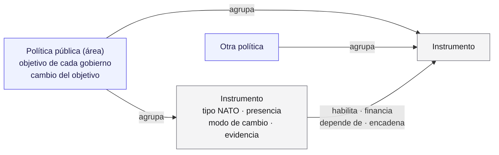
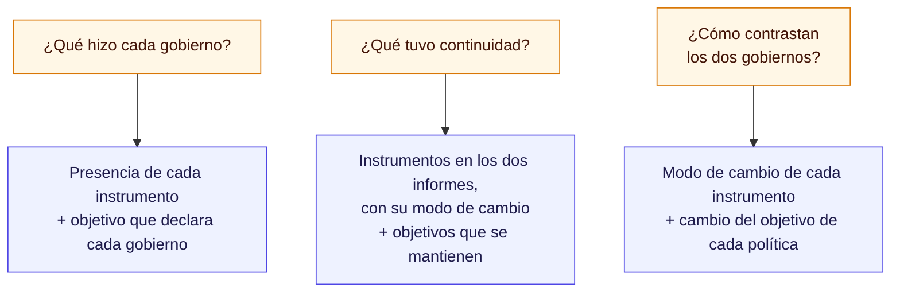
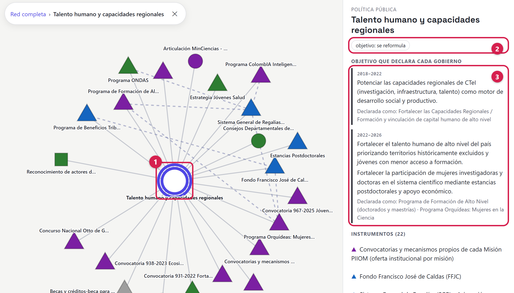
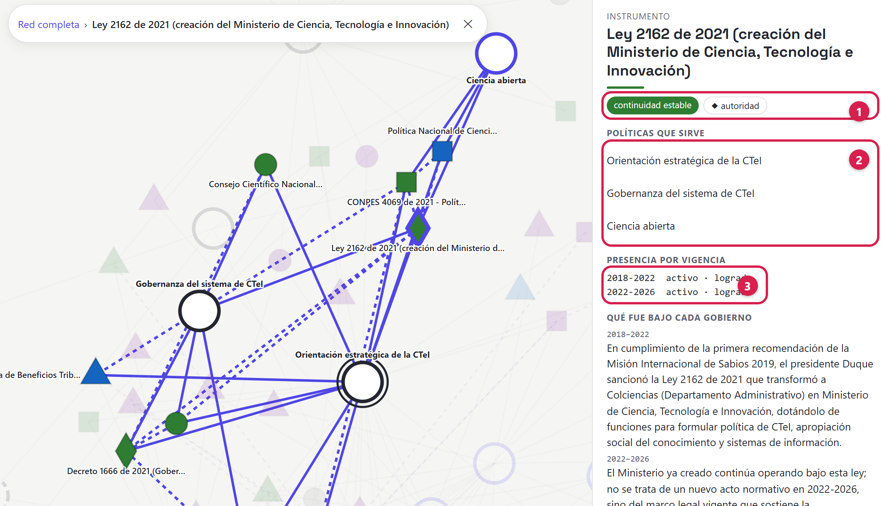
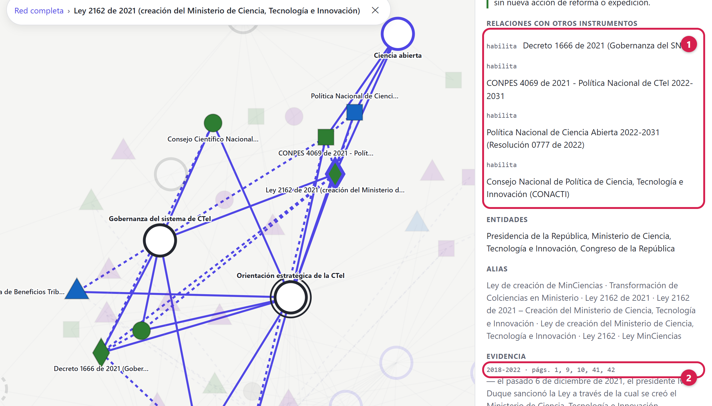

## Resumen

El mapa del laboratorio existe para responder qué hizo un gobierno con lo que heredó del anterior.
Tiene tres piezas: las políticas públicas, los instrumentos con que el Estado las ejecuta y las
relaciones entre esos instrumentos. Juntas muestran qué hizo cada gobierno, qué continuó y cómo
contrastan. Un modelo de lenguaje (Claude Sonnet, de Anthropic; [versión por confirmar]) generó el
contenido y nadie lo ha verificado completo; ver **Cómo lo hicimos**, sección 4.

> **Verifíquelo en el mapa.** El mapa está publicado en
> [https://complexluise.github.io/laboratorio-cocreacion-empalme-colombia/#/red](https://complexluise.github.io/laboratorio-cocreacion-empalme-colombia/#/red).
> Cada captura de este documento sale de ese sitio: busque la política o el instrumento por su
> nombre y compare.

## La serie

Cuatro documentos explican el laboratorio:

1. **Marco teórico**: de dónde salen las categorías del mapa.
2. **Ontología del mapa** (este documento): qué contiene el mapa y cómo se relacionan sus piezas.
3. **Cómo lo hicimos**: el método, qué hizo un modelo de lenguaje y qué revisaron personas.
4. **Encuadre de la actividad**: cómo se usa el mapa en el seminario.

## Mapa de lectura

| Sección | Pregunta que responde |
|---|---|
| 1. El mapa de un vistazo | ¿Qué piezas tiene? |
| 2. Tres preguntas antes que los datos | ¿Para qué existe cada pieza? |
| 3. Las piezas, una por una | ¿Qué guarda el mapa de cada política, instrumento y relación? |
| 4. Cómo responde el mapa a las tres preguntas | ¿Qué se puede leer hoy en el sector? |
| 5. Lo que el mapa no contiene | ¿Qué no se puede afirmar con él? |

## 1. El mapa de un vistazo

**En una sola red caben 14 políticas, 93 instrumentos y 22 relaciones.** Es el sector de Ciencia,
Tecnología e Innovación en dos gobiernos: el de Iván Duque (2018–2022) y el de Gustavo Petro
(2022–2026). La fuente son sus **informes de empalme**: el informe que cada entidad deja al terminar
un gobierno, y que publica el Departamento Nacional de Planeación (DNP).

Una **ontología** es la lista de las clases de cosas que distingue el mapa y de cómo se
relacionan. La del mapa es corta (Figura 1):

- una **política pública** es un área que atraviesa gobiernos, como el talento humano para la
  ciencia;
- un **instrumento** es el medio concreto con que el Estado actúa en esa área: una ley, un fondo,
  un programa, una convocatoria;
- una **relación** une dos instrumentos: una ley que crea un sistema, un fondo que financia un
  programa.

*Figura 1. Las tres piezas del mapa. Una política agrupa instrumentos; un instrumento puede servir a
varias políticas; dos instrumentos pueden estar relacionados.*

El mapa es una **red bipartita**: tiene dos clases de puntos (políticas e instrumentos), y las
líneas principales van de una clase a la otra. En el sitio, las políticas son círculos y los
instrumentos son símbolos cuya forma indica su tipo NATO (sección 3.2). Los instrumentos
reemplazaron a las frases sueltas de la primera versión, porque son lo que persiste entre gobiernos
(ver **Marco teórico**, sección 2).

## 2. Tres preguntas antes que los datos

**El equipo decidió qué entra al mapa con tres preguntas.** La regla: una pieza que no ayuda a
responder alguna de ellas no entra.

Esas preguntas se llaman **preguntas de competencia**: lo que el mapa tiene que poder contestar
(Figura 2).

*Figura 2. Cada pregunta y las piezas del mapa que la responden.*

Un ejemplo de lo que la regla deja afuera: los informes traen el presupuesto de cada entidad, pero
el mapa no lo guarda como dato aparte. Las cifras entran solo como evidencia de un instrumento
(sección 3.5). La regla tiene una excepción: los datos que sirven para buscar y verificar, como los
nombres alternativos y las entidades de cada instrumento.

## 3. Las piezas, una por una

### 3.1 La política pública: un área con un objetivo por gobierno

**Los dos gobiernos atendieron el talento humano, pero no persiguieron lo mismo.** En 2018–2022 el
objetivo declarado era «potenciar las capacidades regionales de CTeI [ciencia, tecnología e
innovación] (investigación, infraestructura, talento) como motor de desarrollo social y
productivo». En 2022–2026 son dos: formar talento de alto nivel «priorizando territorios
históricamente excluidos» y «fortalecer la participación de mujeres investigadoras».

Para comparar eso, la política tiene que existir en los dos gobiernos aunque cada uno la nombre
distinto. Por eso una política del mapa es un **área persistente**, y guarda tres cosas (Figura 3):

| Lo que guarda | Qué es | En el ejemplo |
|---|---|---|
| Nombre del área | El problema público que atraviesa gobiernos | Talento humano y capacidades regionales |
| Objetivo de cada gobierno | Lo que el informe declara, con sus palabras, y cómo nombra el gobierno esa política | Un objetivo en 2018–2022; dos en 2022–2026 |
| Cambio del objetivo | Se mantiene, se reformula, nuevo o no declarado | Se reformula |

*Figura 3. La política «Talento humano y capacidades regionales», seleccionada en la red. (1) La
política y los 22 instrumentos que agrupa. (2) El cambio del objetivo: se reformula. (3) El objetivo
que declara cada gobierno, con el nombre que le da cada informe. Salida del modelo, sin verificar.*

Si un gobierno no le declara objetivo a un área, el mapa la registra como **no declarado**. En el
sector pasa con la innovación empresarial en 2022–2026: 4 de sus 8 instrumentos siguen, pero el
informe no le declara objetivo. En el sitio se ve como un anillo punteado (ver **Marco teórico**,
Figura 6).

Las 14 áreas son una propuesta de otro modelo de lenguaje (Claude Opus 4.8, de Anthropic); el
equipo aprobó cómo se dividieron (ver **Cómo lo hicimos**, paso 6).

### 3.2 El instrumento: una ficha por cada medio de acción

**La Ley 2162 de 2021, que creó el Ministerio de Ciencia, aparece en los dos informes.** El de
2018–2022 la reporta como recién sancionada; el de 2022–2026, como la ley bajo la que el ministerio
sigue operando.

*Figura 4. La ficha de la Ley 2162 de 2021. (1) El modo de cambio (continuidad estable) y el tipo
(autoridad). (2) Las tres políticas a las que sirve. (3) Su presencia en cada informe: logrado en
los dos. Salida del modelo, sin verificar.*

Cada uno de los 93 instrumentos del mapa tiene una ficha con los mismos campos (Figura 4):

| Campo | Qué guarda | En la Ley 2162 |
|---|---|---|
| Nombre y nombres alternativos | Cómo lo llama cada informe | «Ley de creación de MinCiencias», «Ley 2162», entre otros |
| Tipo NATO | El recurso del Estado que usa: nodalidad (la información), autoridad (la norma), tesoro (el dinero) u organización (personal y medios propios). NATO son las iniciales en inglés de los cuatro recursos que distingue Christopher Hood | Autoridad |
| Políticas a las que sirve | Una o varias áreas | Orientación estratégica, gobernanza del sistema, ciencia abierta |
| Presencia por gobierno | Si el informe lo menciona y cómo: **propuesto** (anunciado, sin ejecución reportada), **logrado** (ejecutado, con resultado reportado) o **pendiente** (inconcluso o recomendado al gobierno posterior) | Logrado en los dos |
| Modo de cambio | Qué le pasó entre un gobierno y otro: uno de los seis modos de la tabla siguiente | Continuidad estable |
| Qué fue en cada gobierno | Una descripción breve por informe | 2018–2022: «transformó a Colciencias (Departamento Administrativo) en Ministerio de Ciencia, Tecnología e Innovación»; 2022–2026: «El Ministerio ya creado continúa operando bajo esta ley» |
| Entidades | Quién lo ejecuta | Presidencia, Ministerio de Ciencia, Congreso |
| Evidencia | Páginas y cifras del informe | Páginas 1, 9, 10, 41 y 42 del informe de 2018–2022 |
| Confianza | Alta, media o baja, según quien revise | Vacío |

Los seis modos de cambio son:

| Modo de cambio | Qué significa en el mapa |
|---|---|
| Estratificación | Aparece solo en el informe posterior. |
| Terminación | Aparece solo en el informe anterior. |
| Continuidad estable | Mismo instrumento, mismo uso. |
| Conversión | Mismo instrumento, usado para otro fin. |
| Deriva | Sigue igual, pero el entorno cambió. |
| Reversión | Sigue, pero su rumbo se invierte. |

Los tipos NATO vienen de Hood (1983); los modos de cambio, de Mahoney y Thelen (2010), con
adaptaciones propias. De dónde sale cada uno: ver **Marco teórico**, secciones 3.2 y 3.3.

### 3.3 Los instrumentos compartidos: lo que vuelve red al mapa

**Dos instrumentos sirven a 9 de las 14 políticas:** el Fondo Francisco José de Caldas y el Sistema
General de Regalías. Los dos son fuentes de dinero.

Un instrumento puede servir a varias políticas a la vez. En el sector, 48 de los 93 lo hacen:

| Políticas a las que sirve | Instrumentos |
|---|---|
| Una | 45 |
| Dos | 26 |
| Tres a cinco | 15 |
| Seis o más | 7 |

Sin esos instrumentos compartidos, el mapa sería 14 grupos sueltos, uno por política. Con ellos,
las políticas se conectan, y aparecen preguntas que una política sola no muestra. Si el mismo fondo
cambia de uso en una política, ¿cambia también en las otras?

### 3.4 Las relaciones entre instrumentos

**La mitad de las 22 relaciones del mapa son de un solo tipo: una cosa habilita a otra.** La Ley
2162, por ejemplo, habilita el Decreto 1666 de 2021, sobre la gobernanza del sistema de ciencia, y
la política nacional de ciencia abierta.

Pertenecer a una política no es una relación: es parte de la ficha (sección 3.2). Las relaciones
solo unen instrumentos distintos, y cada una tiene un tipo (Figura 5):

| Tipo | Qué significa | Relaciones | Ejemplo del mapa |
|---|---|---|---|
| Habilita | Una norma da existencia o soporte legal a otro instrumento | 11 | El Decreto 1666 de 2021 habilita el Consejo Científico Nacional |
| Financia | Una fuente de dinero costea otro instrumento | 8 | El Fondo Francisco José de Caldas financia el Programa Orquídeas |
| Encadena | Uno alimenta al otro: sus beneficiarios o productos pasan al siguiente | 2 | La Formación de Alto Nivel encadena con el Programa Orquídeas |
| Depende de | Uno es condición del otro | 1 | La resolución que adoptó las misiones depende de su metodología |

*Figura 5. La parte inferior de la ficha de la Ley 2162. (1) Sus relaciones: habilita cuatro
instrumentos. (2) La evidencia: las páginas del informe de 2018–2022 donde aparece. Salida del
modelo, sin verificar.*

### 3.5 La evidencia

**91 de los 93 instrumentos citan las páginas del informe donde aparecen, y 89 citan una cifra.**
La evidencia permite comprobar el mapa: los informes están publicados en el sitio del DNP, y
cualquiera puede abrirlos en la página citada. Que una ficha cite una página no garantiza que la
página diga lo mismo.

## 4. Cómo responde el mapa a las tres preguntas

**El informe de 2022–2026 menciona 79 instrumentos; el de 2018–2022, 35.** Cada
pregunta se lee en el sitio con un filtro o un color:

| Pregunta | Dónde se ve en el sitio | Qué muestra hoy el sector |
|---|---|---|
| ¿Qué hizo cada gobierno? | El filtro de gobierno (2018–22 o 2022–26) y el objetivo de cada política | 35 instrumentos en el informe de 2018–2022 y 79 en el de 2022–2026 |
| ¿Qué tuvo continuidad? | El filtro de modo de cambio, sin estratificación ni terminación (lo que queda está en los dos informes), y las políticas cuyo objetivo se mantiene | 21 instrumentos aparecen en los dos informes, y 12 de ellos con el mismo uso (continuidad estable); 4 políticas mantienen su objetivo |
| ¿Cómo contrastan los dos gobiernos? | El color de cada instrumento (modo de cambio) y el anillo de cada política (cambio del objetivo) | 58 estratificaciones, 14 terminaciones, 12 continuidades, 8 conversiones y 1 deriva; 6 políticas nuevas y 3 reformuladas |

Parte de esa diferencia puede venir de cómo está escrito cada informe, no de lo que hizo cada
gobierno (ver **Marco teórico**, sección 3.3).

## 5. Lo que el mapa no contiene

- **Un solo sector.** Hoy el mapa cubre Ciencia, Tecnología e Innovación. Otros sectores están en
  preparación.
- **Dos informes, cada uno escrito por un gobierno sobre sí mismo.** El mapa no usa otras fuentes.
  Que un informe calle algo no prueba que no exista: por eso el mapa dice «no declarado», nunca
  «abandonado».
- **Fichas sin verificar ni marcadas con nivel de confianza.** El modelo generó las fichas, los
  objetivos, el cambio del objetivo, los modos de cambio y las relaciones. Nadie los ha revisado
  completos, y el campo de confianza está vacío en los 93 instrumentos (ver **Cómo lo hicimos**,
  sección 4).
- **La conversión es la etiqueta más débil.** Cuando el modelo no le asignó un modo a un
  instrumento presente en los dos informes, un programa le puso «conversión» automáticamente. Los
  datos no dicen cuáles de las 8 salieron así (ver **Cómo lo hicimos**, paso 5). Además, el mapa no
  vincula cada instrumento con el objetivo de cada gobierno: que un instrumento siga bajo un
  objetivo reformulado es una pista, no una prueba.
- **La deriva no tiene medición propia.** Depende de saber que el entorno cambió, y los informes no
  lo dicen. Hay un solo caso.
- **El mismo instrumento puede aparecer dos veces.** El modelo agrupó en una ficha los nombres con
  que cada informe se refiere a un instrumento, pero puede haber dos fichas para la misma cosa. Por
  ejemplo, el programa de beneficios tributarios y el cupo de inversión que lo precedió figuran por
  separado.
- **Los aportes del seminario.** El equipo los sumará como una capa aparte, que no borra lo que
  generó el modelo (ver **Encuadre de la actividad**, sección 6).

## Autoría y uso de inteligencia artificial

**Autoría:** Mercy Garcia, Elizabeth Mesa y Luis Higuera, Laboratorio de cocreación TRAMA.

**Contribuciones:**

- **Conceptualización:** Mercy Garcia y Elizabeth Mesa, en reuniones de trabajo del equipo.
- **Metodología y curaduría de datos:** Luis Higuera.
- **Revisión:** pendiente.

**Uso de inteligencia artificial:** Luis Higuera trabajó con Claude Code (Claude Opus 4.8 y Claude
Opus 5.5, de Anthropic) para convertir las decisiones del equipo en el mapa, el sitio y este
documento. El modelo generó los borradores, el código y la red; el equipo decidió. Un programa calculó las cifras sobre los datos del mapa, y otro tomó las capturas del sitio, las marcó y las recortó. Ninguna persona ha revisado todavía el documento completo.
