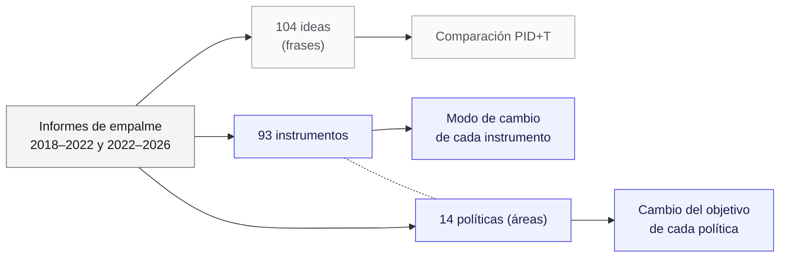
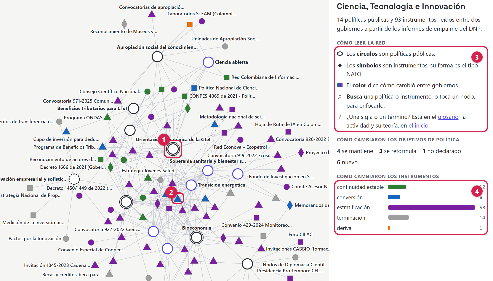
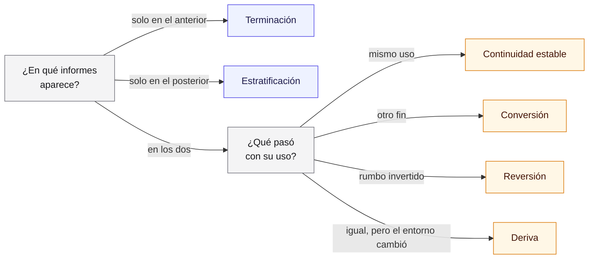
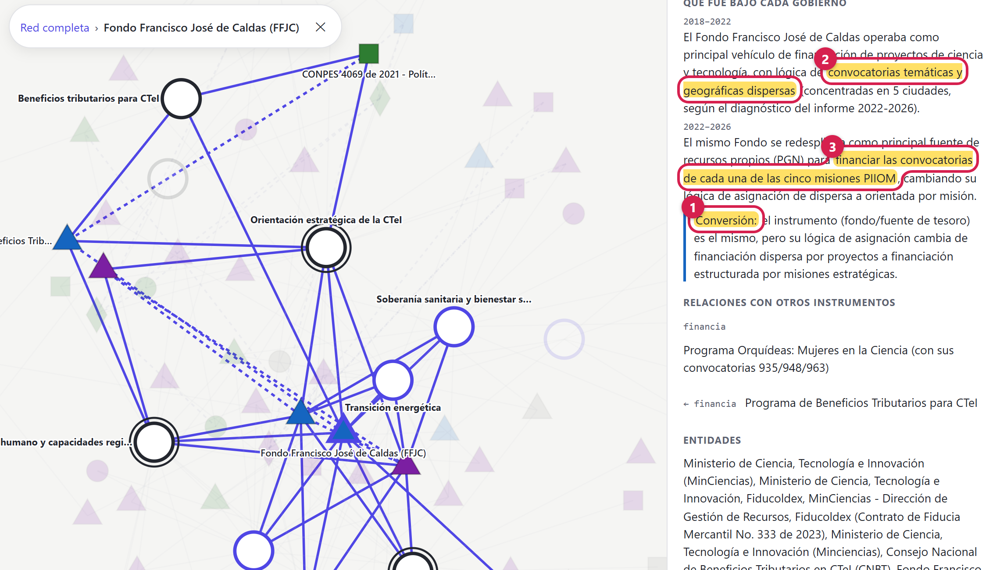
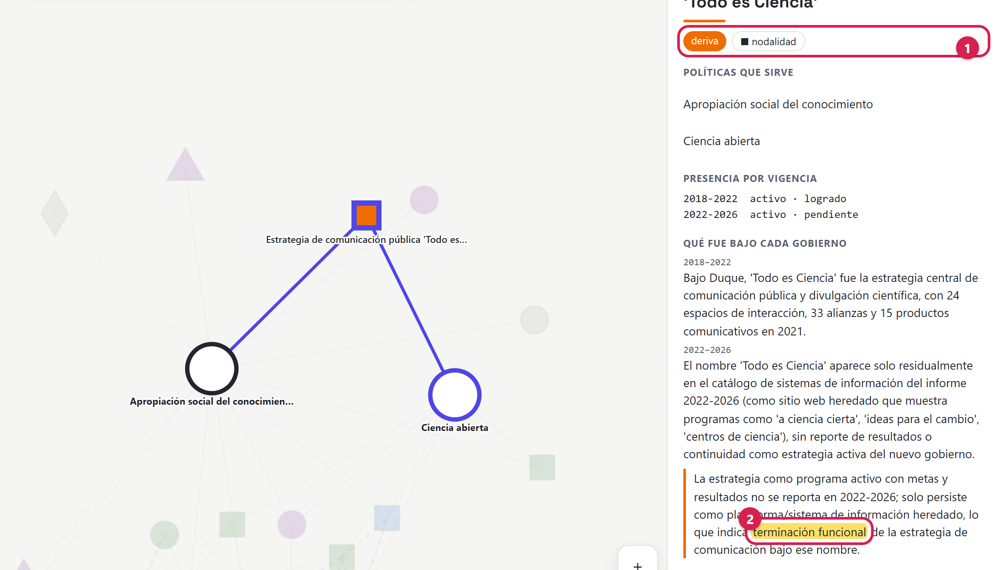
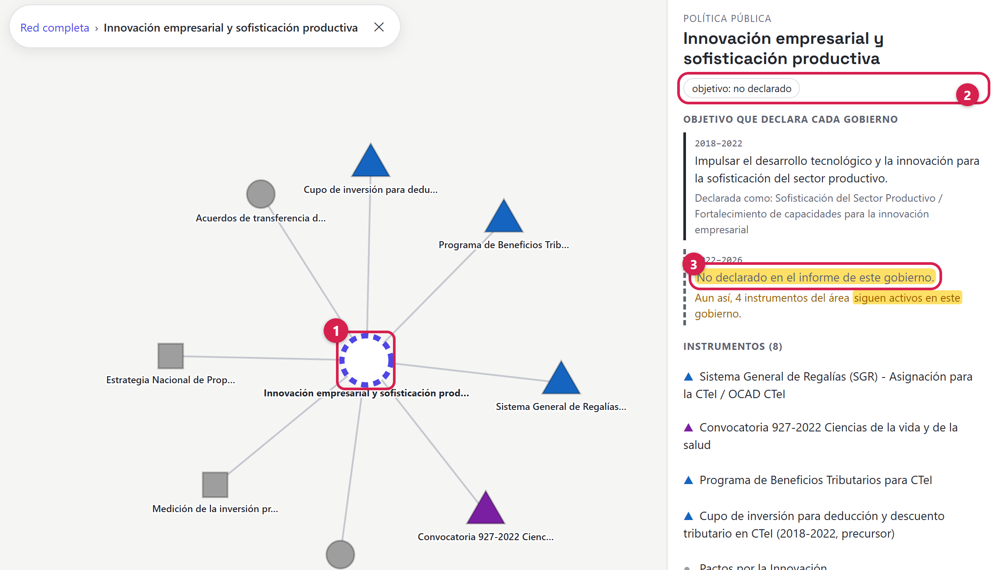
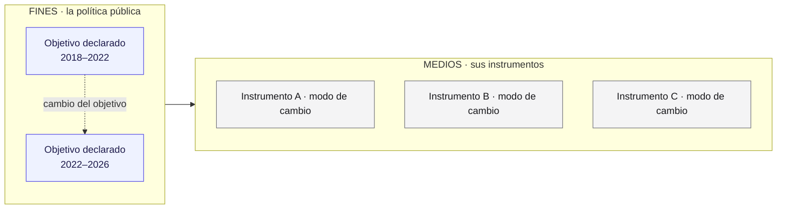

## Resumen

El laboratorio compara los informes de empalme de dos gobiernos colombianos. La idea inicial
comparaba frases sueltas con categorías tomadas de la teoría de la información. No bastaba: las
frases no son lo que persiste entre gobiernos, y esas categorías describen sin explicar. La teoría
política la reemplazó: ahora la unidad del mapa es el instrumento de política pública, el medio con
que actúa el Estado, y su cambio se clasifica con la teoría del cambio institucional gradual. Un
modelo de lenguaje asignó esas categorías, y ninguna persona las ha revisado todas.

> **Verifíquelo en el mapa.** El mapa está publicado en
> [https://complexluise.github.io/laboratorio-cocreacion-empalme-colombia/#/red](https://complexluise.github.io/laboratorio-cocreacion-empalme-colombia/#/red).
> Cada captura de este documento sale de ese sitio, y cada cifra se puede comprobar ahí: busque un
> instrumento o una política por su nombre y mire su descripción en el panel de la derecha.

## La serie

Cuatro documentos explican el laboratorio:

1. **Marco teórico** (este documento): de dónde salen las categorías del mapa.
2. **Ontología del mapa**: qué contiene el mapa y cómo se relacionan sus piezas.
3. **Cómo lo hicimos**: el método, qué hizo un modelo de lenguaje y qué revisaron personas.
4. **Encuadre de la actividad**: cómo se usa el mapa en el seminario.

## Mapa de lectura

| Sección | Pregunta que responde |
|---|---|
| 1. La idea inicial | ¿Con qué empezamos? |
| 2. Por qué no bastaba | ¿Qué falló? |
| 3.1 Sucesión de políticas | ¿Qué es, en teoría, un empalme? |
| 3.2 Instrumentos | ¿Qué compara el mapa? |
| 3.3 Modos de cambio | ¿Cómo cambia un instrumento entre gobiernos? |
| 3.4 Fines y medios | ¿Cómo cambia lo que cada gobierno persigue? |
| 4. Qué quedó de la idea inicial | ¿Qué conservamos y con qué límites? |
| 5 y 6. Síntesis y origen de cada categoría | ¿Qué es nuestro y qué viene de la literatura? |

## 1. La idea inicial

**Cada gobierno que termina deja un informe sobre lo que hizo.** Se llama **informe de empalme**:
cada entidad le entrega al gobierno siguiente qué hizo, qué deja en curso y qué recomienda. El
Departamento Nacional de Planeación (DNP) los publica. El laboratorio trabaja con los de dos
gobiernos: el de Iván Duque (2018–2022) y el de Gustavo Petro (2022–2026). Empezamos por el sector
de Ciencia, Tecnología e Innovación, por ser el más acotado.

La pregunta inicial era: **¿qué aporta cada gobierno a la política de un sector?** El plan tenía tres
pasos:

1. Extraer de cada informe sus **ideas**: frases cortas, cada una con su página y su cifra.
2. Etiquetar cada idea por tema (financiación, talento humano, territorio…) y por tipo (una
   apuesta, un programa, un logro, un pendiente). El equipo diseñó esa clasificación.
3. Comparar las ideas de los dos gobiernos con cuatro categorías:
   - **Redundancia**: los dos gobiernos dicen lo mismo.
   - **Unicidad**: solo uno de los dos lo dice.
   - **Sinergia**: algo que surge solo al combinar lo de ambos.
   - **Tensión**: un gobierno contradice o revierte lo del otro.

Un modelo de lenguaje (Claude Opus 4.8, de Anthropic) extrajo las ideas de cada informe, las
etiquetó con esa clasificación y generó la comparación entre los dos gobiernos.

Las tres primeras categorías vienen de la **descomposición parcial de información** (Williams y
Beer, 2010), una herramienta de la teoría de la información. Mide cuánta información aportan
varias fuentes sobre algo: la que comparten, la que solo tiene una y la que aparece solo al
juntarlas. La cuarta, la tensión, la agregamos nosotros. Llamamos al conjunto **PID+T**: la sigla
de *partial information decomposition*, más la T de tensión. La usamos como analogía, no como cálculo
(sección 4).

A lo que comparábamos le dimos un nombre provisional: **objeto de política**. Un objeto era
cualquier cosa con nombre propio que apareciera en los informes: un programa, una ley, un fondo,
un sistema.

## 2. Por qué no bastaba

**La extracción dejó 104 ideas del sector, pero hablaban de solo 32 cosas.** Un modelo de lenguaje
(Gemini, de Google) agrupó las 104 ideas según el programa, la norma o el fondo que nombraba cada
una, y salieron 32 grupos. De esos 32, 13 aparecían en los informes de los dos gobiernos. Al ver ese
resultado, el equipo identificó tres problemas.

**Las ideas no eran la unidad correcta.** Una idea es una frase. El Fondo Francisco José de Caldas
aparece en los dos informes: son dos frases distintas, pero un solo fondo. Con ideas, la
continuidad queda como un vínculo entre dos frases. Pero lo que continúa no son las frases: es **el
fondo**. La unidad tenía que ser la cosa que
persiste, no lo que se dice de ella.

**«Objeto de política» no dice nada.** No es un término de la disciplina. Lo inventamos para
ordenar datos, y abarca tanto que no comunica.

**PID+T describe, pero no explica.** Dice si algo aparece en un gobierno, en el otro o en ambos.
No dice qué significa eso para una política pública: si lo que se repite sigue igual o cambió de
propósito, si lo que desapareció terminó o solo dejó de mencionarse.

Lo que intentábamos describir **ya tiene nombre** en la teoría política. No había que inventar
vocabulario, había que encontrarlo.

*Figura 1. De la idea inicial (gris) al mapa actual (azul). La unidad pasó de la frase al
instrumento, y se sumaron las políticas con su objetivo.*

## 3. La idea, leída con la teoría política

### 3.1 El marco general: el empalme como **sucesión de políticas**

**De los 35 instrumentos del informe de 2018–2022, 21 reaparecen en el de 2022–2026.** Son cifras
de la lista que generó un modelo de lenguaje (Claude, de Anthropic), sin verificar una por una. Aun
así, sugieren que el gobierno posterior no empezó de cero.

Ese fenómeno tiene nombre. Brian Hogwood y B. Guy Peters (1982, 1983) observaron que los gobiernos
casi nunca empiezan de cero: la mayoría de las políticas nuevas reemplazan o modifican otras que ya
existían. Distinguen cuatro formas de tratar lo heredado:

- **mantener** lo heredado;
- **sucederlo**: cambiarlo sin cambiar el propósito;
- **terminarlo**;
- **innovar** con algo nuevo.

Un informe de empalme responde casi literalmente esa pregunta: qué se hizo con lo heredado. En el
mapa, la Ley 2162 de 2021, que creó el Ministerio de Ciencia, aparece en los dos informes con el
mismo uso: se mantiene. Los Pactos por la Innovación aparecen solo en el de 2018–2022. Peter deLeon
(1978) estudió ese último caso en detalle: cómo y por qué terminan las políticas.

**Qué cambió en el mapa.** La pregunta dejó de ser «qué aporta cada gobierno» y pasó a ser «qué hizo
el gobierno posterior con lo que heredó». Las secciones 3.2 a 3.4 la responden en tres planos: con
qué actúa el Estado, cómo cambia eso entre gobiernos y para qué lo usa.

### 3.2 De «objeto» a **instrumento de política pública**

**Casi la mitad del mapa es dinero.** De los 93 instrumentos de la lista del sector, 48 son
fondos, convocatorias, becas o beneficios tributarios.

Para ver eso hace falta una clasificación, y la literatura la tiene. Lo que llamábamos objeto es lo
que la literatura llama **instrumento de política pública**: el medio concreto con que el Estado
actúa. Dos corrientes lo estudian:

- **Christopher Hood** (*The Tools of Government*, 1983; actualizado con Helen Margetts en 2007)
  sostiene que el Estado gobierna con un repertorio limitado de herramientas. Las clasifica por el
  recurso que usan, con la sigla **NATO**:
  - **Nodalidad**: la información. El Estado está en el centro de muchas redes y puede recoger y
    difundir datos.
  - **Autoridad**: el poder legal de ordenar, prohibir, permitir o certificar.
  - **Tesoro**: el dinero y los bienes que el Estado puede entregar o cobrar.
  - **Organización**: el personal, las sedes y los equipos propios con que actúa directamente.
- **Pierre Lascoumes y Patrick Le Galès** (*Gouverner par les instruments*, 2004) agregan que **un
  instrumento no es neutro**: cada uno lleva una idea de cómo debe gobernarse y de cómo se
  relacionan el Estado y la sociedad. Elegir un instrumento ya es una decisión política.

| Tipo NATO | Instrumentos en el mapa | Ejemplo |
|---|---|---|
| Tesoro | 48 | Fondo Francisco José de Caldas |
| Nodalidad | 19 | Estrategia de comunicación pública «Todo es Ciencia» |
| Organización | 19 | Consejos Departamentales de Ciencia, Tecnología e Innovación |
| Autoridad | 7 | Ley 2162 de 2021, que creó el Ministerio de Ciencia |

Un instrumento real suele combinar recursos, y el mapa le asigna uno solo: el dominante. El criterio
es nuestro, no de Hood: un programa no es «organización» solo por llamarse programa; si lo que hace
es repartir dinero, es tesoro. Un modelo de lenguaje (Claude, de Anthropic) asignó un tipo a cada
instrumento, con ese criterio escrito en sus instrucciones. Nadie ha verificado las 93 asignaciones
(ver **Cómo lo hicimos**), así que el peso del tesoro puede reflejar la política del sector o las
asignaciones del modelo. Una persona tiene que revisarlo antes de sacar conclusiones.

Este cambio resuelve también el problema de la unidad. La unidad de comparación dejó de ser la
frase y pasó a ser el instrumento, que conserva su identidad de un informe a otro.

**Qué cambió en el mapa.** El mapa es una red: puntos unidos por líneas. Hay dos clases de puntos,
las políticas (sección 3.4) y los instrumentos. La forma de cada instrumento indica su tipo NATO.

*Figura 2. La red de Ciencia, Tecnología e Innovación en el sitio del laboratorio. (1) Una política:
los círculos grandes. (2) Un instrumento, el Fondo Francisco José de Caldas: su forma de triángulo
indica tesoro. (3) La guía de lectura: círculos, formas y colores. (4) Cuántos instrumentos tiene
cada modo de cambio.*

Para ver la red en vivo, con todos sus nombres y filtros, abra [https://complexluise.github.io/laboratorio-cocreacion-empalme-colombia/#/red](https://complexluise.github.io/laboratorio-cocreacion-empalme-colombia/#/red).

### 3.3 De «redundancia y unicidad» a los **modos de cambio gradual**

**Casi dos de cada tres instrumentos del mapa aparecen solo en el informe posterior.** De 93, 58
figuran solo en el de 2022–2026. ¿Un gobierno que lo cambió casi todo, o algo más?

Para responder hace falta distinguir formas de cambio. Entre un gobierno y otro, las instituciones
de un sector suelen cambiar poco a poco, sin rupturas. El **institucionalismo histórico**, la
corriente que estudia cómo cambian las instituciones en el tiempo, tiene nombres para esas formas.
James Mahoney y Kathleen Thelen (2010), a partir del trabajo de Wolfgang Streeck y Thelen (2005),
describen cuatro:

| Modo | Qué pasa |
|---|---|
| **Estratificación** (*layering*) | Se agregan reglas nuevas encima o al lado de las que ya existen. |
| **Desplazamiento** (*displacement*) | Se quitan reglas existentes y se ponen otras nuevas. |
| **Conversión** (*conversion*) | La regla sigue igual en el papel, pero se usa para otros fines. |
| **Deriva** (*drift*) | La regla sigue igual, pero el entorno cambia y la regla no se ajusta, así que su efecto cambia. |

Streeck y Thelen describían además el **agotamiento** (*exhaustion*): un deterioro gradual que la
propia institución produce, por ejemplo al extenderse más de lo que puede sostener.

Falta un caso: lo que no cambia. Para eso, la lectura teórica más cercana es la **dependencia de la
trayectoria** de Paul Pierson (2000, 2004). Pierson explica por qué las políticas persisten: en un
proceso de rendimientos crecientes, cada paso en una dirección hace más probable el siguiente y más
costoso salirse.

Nuestras categorías iniciales eran una versión borrosa de esta tipología. La unicidad, por ejemplo,
mezclaba dos cosas muy distintas: lo que un gobierno **suma** y lo que **deja**. La teoría las
separa. El mapa quedó con seis modos:

| Antes (PID+T) | Ahora: modo de cambio | Qué significa en el mapa | Instrumentos | De dónde viene |
|---|---|---|---|---|
| Unicidad, solo en el gobierno posterior | **Estratificación** | Aparece solo en el informe posterior. | 58 | Adaptación de Mahoney y Thelen |
| Unicidad, solo en el gobierno anterior | **Terminación** | Aparece solo en el informe anterior. | 14 | deLeon (1978); agrupa además el desplazamiento y el agotamiento |
| Redundancia | **Continuidad estable** | Mismo instrumento, mismo uso. | 12 | Compatible con la dependencia de la trayectoria (Pierson) |
| Redundancia con otro uso | **Conversión** | Mismo instrumento, usado para otro fin. | 8 | Mahoney y Thelen |
| Redundancia sin cambio formal | **Deriva** | Sigue igual, pero el entorno cambió. | 1 | Mahoney y Thelen |
| Tensión | **Reversión** | Sigue, pero su rumbo se invierte. | 0 | Categoría propia |

*Figura 3. Cómo se asigna el modo de cambio. Los dos modos en azul salen directo de la lista: el
instrumento figura en un solo informe. Los cuatro en naranja exigen juzgar lo que dice cada
informe.*

**Un ejemplo de conversión.** En el informe de 2018–2022, el Fondo Francisco José de Caldas
financia proyectos de ciencia con convocatorias dispersas. En el de 2022–2026, el mismo fondo
financia las convocatorias de cinco misiones de investigación. El instrumento es el mismo; su fin
cambió. Una advertencia: cuando el modelo no asignó un modo a un instrumento que está en los dos
informes, un programa le puso «conversión» por defecto (ver **Cómo lo hicimos**, paso 5). En este
caso la descripción del modelo justifica la conversión; en otros, hay que comprobarlo.

*Figura 4. El Fondo Francisco José de Caldas, seleccionado en la red. (1) El modo de cambio
asignado: conversión. (2) Su uso en 2018–2022: convocatorias dispersas. (3) Su uso en 2022–2026:
financiar las cinco misiones. Los textos de la derecha los generó un modelo de lenguaje
a partir de los informes.*

Sobre la **continuidad estable**: ver un instrumento en los dos informes no prueba que opere el
mecanismo de Pierson, y Mahoney y Thelen advierten que el bloqueo total es raro. La continuidad del
mapa es compatible con Pierson; no lo demuestra.

**Lo que el mapa adapta o inventa.** Hay cuatro diferencias con la teoría:

- **Aplicamos a instrumentos lo que la teoría dice de reglas.** Mahoney y Thelen hablan de
  instituciones; nosotros, de los instrumentos con que se ejecutan.
- **Comparamos dos informes, no una historia larga.** Los autores siguen reglas a lo largo de años.
  Por eso la estratificación del mapa no comprueba que lo anterior siga: solo dice que algo aparece
  nuevo. Si reemplazó a otro instrumento, en la teoría sería desplazamiento.
- **La terminación del mapa no prueba que algo terminó.** Cada gobierno escribe su propio informe,
  y que el segundo no mencione un instrumento no significa que haya desaparecido. Bajo esta
  etiqueta caben el reemplazo por otro instrumento, el fin real, el desgaste o el simple silencio
  del informe.
- **La reversión es nuestra.** La literatura más cercana estudia el **desmantelamiento** de
  políticas (Bauer y otros, 2012): recortarlas, reducirlas o eliminarlas. Invertir el rumbo de un
  instrumento que sigue vivo no es exactamente eso. En los datos del sector todavía no hay ningún
  caso.

**Volviendo a los 58 instrumentos nuevos.** El informe de 2022–2026 menciona 79 instrumentos
activos; el de 2018–2022, 35. Una hipótesis por verificar: parte de la estratificación puede venir
de cómo está escrito cada informe, y no de lo que hizo cada gobierno.

**Qué cambió en el mapa.** Cada instrumento lleva su modo de cambio, que se ve como el color del
punto. La estratificación y la terminación salen directo de la lista: el instrumento figura en un
solo informe. Los otros cuatro exigen juzgar lo que dice cada informe, y nadie lo ha hecho todavía.
Un modelo de lenguaje (Claude, de Anthropic) asignó el modo a cada instrumento, y ninguna persona lo
ha verificado (ver **Cómo lo hicimos**). Un caso muestra por qué importa: a la estrategia «Todo es
Ciencia» el modelo le asignó deriva, pero la descripción que el mismo modelo generó habla de una
«terminación funcional».

*Figura 5. Una inconsistencia en la salida del modelo. (1) El modo asignado: deriva. (2) La
descripción que generó el mismo modelo: «terminación funcional». Encontrar estos casos es tarea de
las personas que revisan el mapa.*

### 3.4 De «qué aporta cada gobierno» a **fines y medios**

**El informe de 2022–2026 no le declara objetivo al área de innovación empresarial, pero 4 de sus 8
instrumentos siguen apareciendo.** El de 2018–2022 sí le declaraba uno: «impulsar el desarrollo
tecnológico y la innovación para la sofisticación del sector productivo». Entre los instrumentos
que siguen están los beneficios tributarios para la innovación.

*Figura 6. Un área huérfana. (1) La política en la red: el anillo punteado indica que no tiene
objetivo declarado. (2) La etiqueta del cambio del objetivo. (3) El informe de 2022–2026 no le
declara objetivo, aunque cuatro de sus instrumentos siguen activos (resaltado).*

Para ver casos así, el mapa no basta con los **medios**: los instrumentos. Necesita los **fines**:
para qué los usa cada gobierno.

- **Peter Hall** (1993) distingue tres órdenes de cambio: ajustar un instrumento (primer orden),
  cambiar de instrumento (segundo orden) o cambiar las metas que hay detrás (tercer orden). Para
  Hall, el tercer orden es el más profundo: cambia el paradigma de la política.
- **Michael Howlett y Benjamin Cashore** (2009) parten de Hall y lo ordenan en seis elementos. Los
  fines tienen tres niveles, de lo más abstracto a lo más concreto: **metas** (*goals*),
  **objetivos** de programa (*objectives*) y **ajustes** (*settings*). Los medios se separan en los
  mismos tres niveles. Advierten además que un cambio profundo también puede llegar por acumulación:
  muchos ajustes pequeños que, con los años, vuelven irreconocibles las metas originales.

La conversión de Mahoney y Thelen (el mismo instrumento, con otro fin) solo se puede ver si se sabe
qué fin perseguía cada gobierno. Por eso el mapa agrupa los instrumentos en **políticas públicas**.
Una política es un **área persistente**: un problema público que atraviesa gobiernos, como el
talento humano para la ciencia o la innovación empresarial. Cada gobierno puede
declararle un **objetivo** a cada área. El mapa registra cómo cambió ese objetivo con cuatro
valores:

| Cambio del objetivo | Qué significa | Áreas del sector |
|---|---|---|
| **Se mantiene** | Los dos gobiernos declaran el área con el mismo objetivo. | 4 |
| **Se reformula** | Los dos gobiernos atienden el área, pero con otro enfoque u objetivo. | 3 |
| **Nuevo** | Solo el gobierno posterior declara el área. | 6 |
| **No declarado** | El gobierno posterior no le declara objetivo al área, aunque sus instrumentos sigan. | 1 |

*Figura 7. Fines y medios en el mapa. La política guarda el objetivo que declaró cada gobierno (los
fines). Sus instrumentos (los medios) llevan cada uno su modo de cambio.*

**Estas cuatro categorías son nuestras**, no de un autor. Se parecen a la tipología de Hogwood y
Peters (sección 3.1): *se mantiene* al mantenimiento, *se reformula* a la sucesión y *nuevo* a la
innovación. Pero un informe de empalme declara objetivos de programa, no paradigmas. Un «se
reformula» no es, por sí solo, un cambio de tercer orden.

Decimos **«no declarado» y no «abandonado»**, como con la terminación: cada gobierno escribe sobre
sí mismo, y su silencio no prueba nada. Un área sin objetivo declarado pero con instrumentos
activos queda **huérfana**, como la de innovación empresarial: los medios siguen aunque el fin ya
no se nombre. Es el tipo de caso donde vale preguntarse si opera la dependencia de la trayectoria.

Un modelo de lenguaje (Claude Opus 4.8, de Anthropic) propuso las 14 áreas del sector, y el equipo aprobó cómo
se dividieron, no su contenido. El cambio del objetivo de cada área tampoco lo ha verificado una persona (ver **Cómo lo
hicimos**).

**Qué cambió en el mapa.** Las políticas son los centros de la red, y un anillo alrededor de cada
una indica cómo cambió su objetivo. Un instrumento que continúa bajo un objetivo que se reformula es
la pista para buscar conversión.

## 4. Qué quedó de la idea inicial

**En el mapa, el Fondo Francisco José de Caldas financia el Programa Orquídeas: Mujeres en la Ciencia.** Esa
relación entre dos instrumentos es lo que queda de la sinergia de la idea inicial. PID+T no
desapareció: cambió de papel.

- **Como criterio para ordenar, sigue sirviendo.** Preguntar qué aparece en un gobierno, en el otro
  o en ambos es el primer paso para asignar un modo de cambio.
- **Como explicación, la reemplaza la teoría política.** PID+T ordena lo que vemos; el
  institucionalismo histórico dice qué significa.
- **La sinergia** pasó a ser las relaciones entre instrumentos: un fondo que financia un programa,
  una ley que habilita un sistema o un programa que alimenta a otro (ver **Ontología del mapa**,
  sección 3.4).
- **La tensión** pasó a ser la reversión.

Una advertencia: la descomposición parcial de información es teoría de la información, no teoría
política, y aquí solo funciona como **metáfora**. Williams y Beer miden cuánta información dan
varias fuentes sobre una variable que se quiere predecir, y para eso necesitan probabilidades
calculadas sobre muchas observaciones. Dos informes de empalme no dan eso: en el mapa,
«redundante» quiere decir solo que algo aparece en los dos informes. La analogía ayuda a un
público que viene de los sistemas complejos, pero no es un marco de la ciencia política y no se
puede calcular.

## 5. En una frase

> El mapa representa los **instrumentos de política pública** de un sector como una red. Para cada
> instrumento registra cómo cambió entre los informes de empalme de dos gobiernos, con una
> adaptación de la tipología de **cambio institucional gradual** de Mahoney y Thelen. Para cada
> política registra cómo cambió su objetivo.

## 6. El origen de cada categoría

| Categoría | Origen |
|---|---|
| Instrumento de política pública | Literatura: Hood; Lascoumes y Le Galès |
| Tipo de instrumento (NATO) | Literatura: Hood. El criterio del recurso dominante es nuestro |
| Política pública como área persistente | Propia, apoyada en la distinción entre fines y medios (Hall; Howlett y Cashore) |
| Cambio del objetivo (se mantiene, se reformula, nuevo, no declarado) | Propia. Analogía parcial con Hogwood y Peters |
| Estratificación | Adaptación de Mahoney y Thelen a dos informes |
| Terminación | deLeon; agrupa además el desplazamiento y el agotamiento de Mahoney, Streeck y Thelen |
| Conversión, deriva | Literatura: Mahoney y Thelen, aplicada a instrumentos |
| Continuidad estable | Adaptación: compatible con la dependencia de la trayectoria (Pierson), sin probar su mecanismo |
| Reversión | Propia. Lo más cercano es el desmantelamiento (Bauer y otros) |
| Relaciones entre instrumentos (habilita, financia, depende de, encadena) | Propias |

Cómo se aplican estas categorías a los datos está en **Ontología del mapa**. Quién las aplicó, y qué
está revisado, en **Cómo lo hicimos**.

## Qué está cotejado con las fuentes

Una consulta a un modelo de lenguaje (Claude Opus 5.5, de Anthropic) contrastó las afirmaciones de este
documento con los textos originales disponibles, y marcó citas literales con su página. Ninguna persona ha verificado todavía esas citas.

- **Contrastado con el original por el modelo:** Howlett y Cashore (2009), Pierson (2000, en su
  traducción al español de 2017) y Williams y Beer (2010).
- **Contrastado en parte:** Mahoney y Thelen (2010). Solo estaban disponibles las primeras diez
  páginas del capítulo. Las definiciones de los cuatro modos están en las páginas 15 a 18, que nadie
  ha revisado todavía.
- **Sin contrastar:** Hood, Lascoumes y Le Galès, Hall, Hogwood y Peters, deLeon, Bauer y otros, y
  Streeck y Thelen. Lo que el documento dice de ellos viene de los documentos internos del equipo,
  no de las obras originales.

Las cifras del mapa corresponden al sector de Ciencia, Tecnología e Innovación tal como está
publicado hoy, sin revisión humana completa.

## Autoría y uso de inteligencia artificial

**Autoría:** Mercy Garcia, Elizabeth Mesa y Luis Higuera, Laboratorio de cocreación TRAMA.

**Contribuciones:**

- **Conceptualización:** Mercy Garcia y Elizabeth Mesa, en reuniones de trabajo del equipo.
- **Metodología y curaduría de datos:** Luis Higuera.
- **Revisión:** Luis Higuera leyó el documento completo y lo corrigió.

**Uso de inteligencia artificial:** Luis Higuera trabajó con Claude Code (Claude Opus 4.8 y Claude
Opus 5.5, de Anthropic) para convertir las decisiones del equipo en el mapa, el sitio y este
documento. El modelo generó los borradores, el código y la red; el equipo decidió. Una consulta al modelo contrastó las afirmaciones teóricas con los textos originales disponibles; ninguna persona ha verificado todavía esas citas.

## Referencias

- Bauer, M. W., Jordan, A., Green-Pedersen, C. y Héritier, A. (eds.) (2012). *Dismantling Public
  Policy: Preferences, Strategies, and Effects*. Oxford University Press.
- deLeon, P. (1978). «A Theory of Policy Termination». En J. V. May y A. Wildavsky (eds.), *The
  Policy Cycle*. Sage.
- Hall, P. A. (1993). «Policy Paradigms, Social Learning, and the State: The Case of Economic
  Policymaking in Britain». *Comparative Politics*, 25(3), 275–296.
  https://doi.org/10.2307/422246
- Hogwood, B. W. y Peters, B. G. (1982). «The dynamics of policy change: Policy succession».
  *Policy Sciences*, 14(3), 225–245. https://doi.org/10.1007/BF00136398
- Hogwood, B. W. y Peters, B. G. (1983). *Policy Dynamics*. St. Martin's Press.
- Hood, C. (1983). *The Tools of Government*. Macmillan.
- Hood, C. y Margetts, H. (2007). *The Tools of Government in the Digital Age*. Palgrave Macmillan.
- Howlett, M. y Cashore, B. (2009). «The Dependent Variable Problem in the Study of Policy Change:
  Understanding Policy Change as a Methodological Problem». *Journal of Comparative Policy
  Analysis*, 11(1), 33–46. https://doi.org/10.1080/13876980802648144
- Lascoumes, P. y Le Galès, P. (2004). *Gouverner par les instruments*. Presses de Sciences Po.
- Lascoumes, P. y Le Galès, P. (2007). «Introduction: Understanding Public Policy through Its
  Instruments». *Governance*, 20(1), 1–21. https://doi.org/10.1111/j.1468-0491.2007.00342.x
- Mahoney, J. y Thelen, K. (2010). «A Theory of Gradual Institutional Change». En J. Mahoney y K.
  Thelen (eds.), *Explaining Institutional Change: Ambiguity, Agency, and Power*. Cambridge
  University Press.
- Pierson, P. (2000). «Increasing Returns, Path Dependence, and the Study of Politics». *American
  Political Science Review*, 94(2), 251–267. https://doi.org/10.2307/2586011. Traducción al
  español: «Rendimientos crecientes, trayectorias dependientes y el estudio de la política».
  Trad. H. S. Arcos Robledo. *Revista Mexicana de Análisis Político y Administración Pública*,
  6(2), 11–50, 2017.
- Pierson, P. (2004). *Politics in Time: History, Institutions, and Social Analysis*. Princeton
  University Press.
- Streeck, W. y Thelen, K. (eds.) (2005). *Beyond Continuity: Institutional Change in Advanced
  Political Economies*. Oxford University Press.
- Williams, P. L. y Beer, R. D. (2010). «Nonnegative Decomposition of Multivariate Information».
  arXiv:1004.2515. https://arxiv.org/abs/1004.2515
